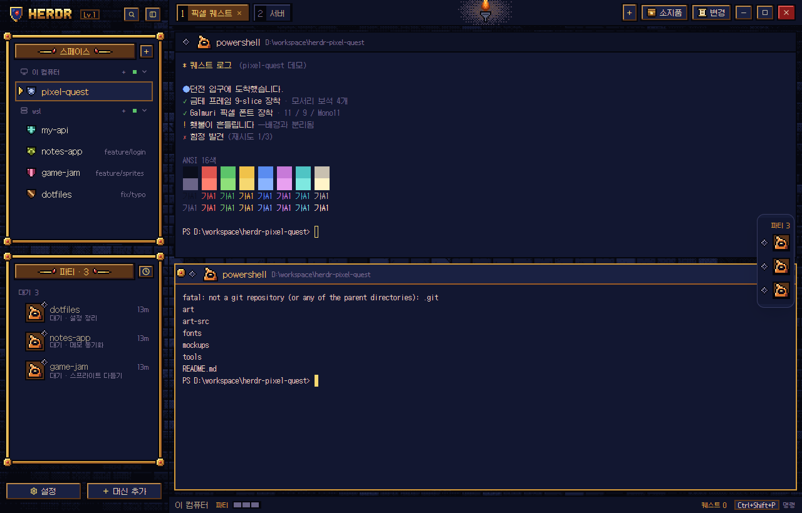
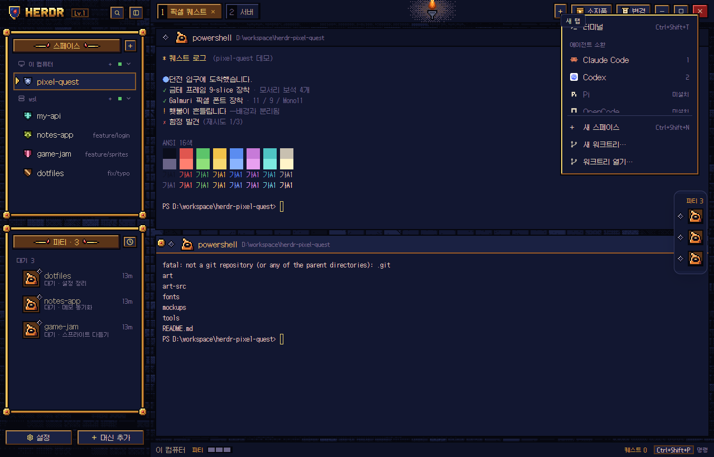
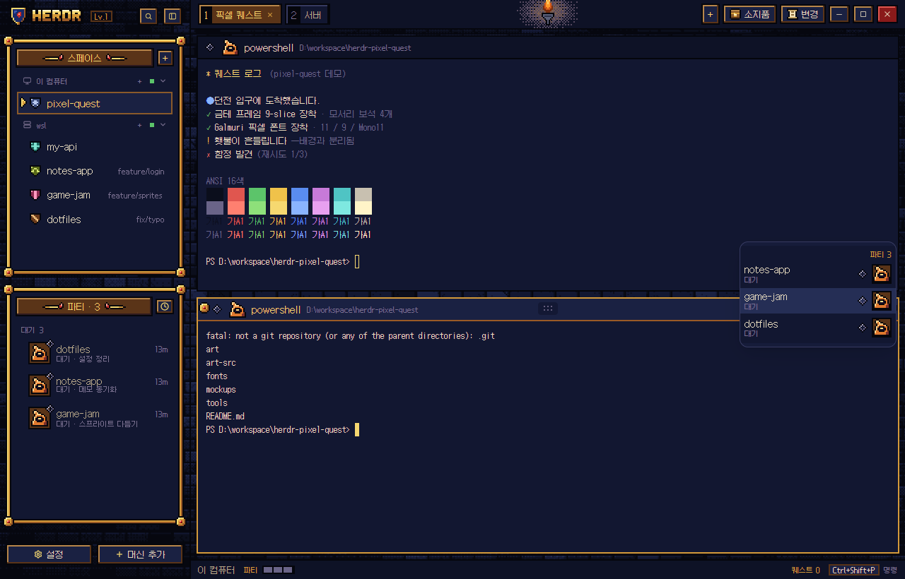
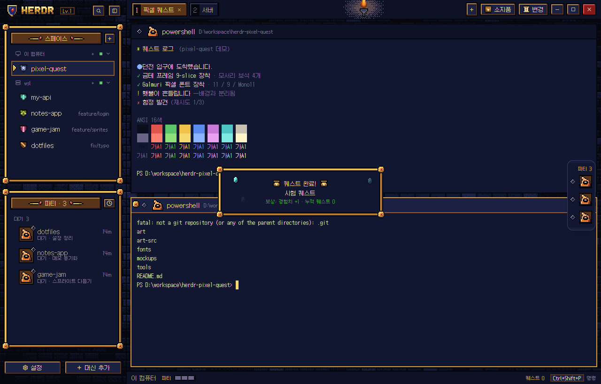
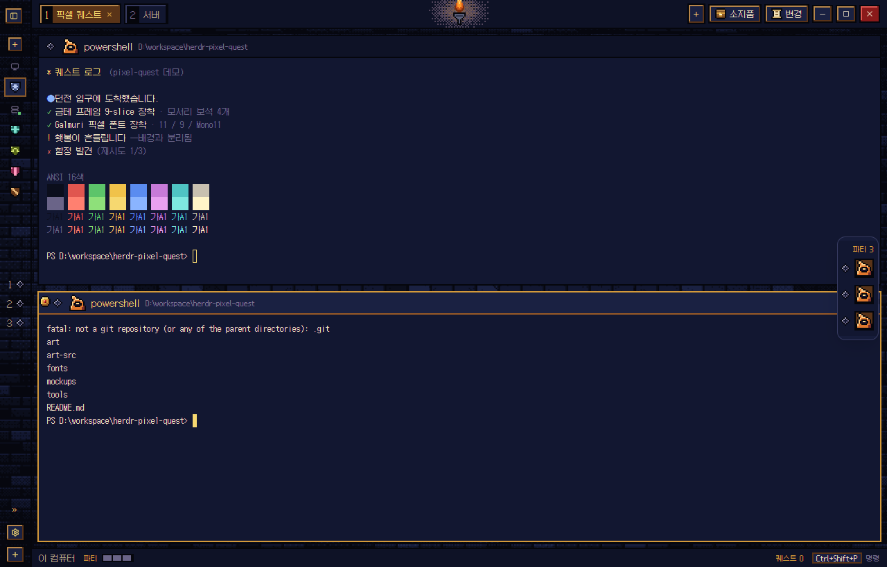

# Pixel Quest — 심연 인벤토리

[Herdr](https://herdr.dev) 데스크톱 앱용 도트(픽셀아트) 레이아웃과 테마입니다.
던전 RPG 인벤토리 창의 감성을 참고한 **오리지널 디자인**입니다.
실제 게임의 로고, 캐릭터, UI 그림은 쓰지 않았습니다.

A pixel-art layout + theme for the Herdr desktop app: gold-framed inventory
panels, status gems, a torch-lit tab bar, a "quest complete" banner and
8-bit alert sounds. Original art; Korean UI labels.



## 들어 있는 것

| 화면 | 내용 |
|---|---|
| 사이드바 | 금테 패널(모서리 보석). **스페이스**는 문장 아이콘으로, 선택한 항목은 청동 테두리와 흔들리는 커서로 표시. **파티**(에이전트)는 초상, 상태 보석, 상태 한 줄로 표시 |
| 탭 바 | 번호 칸이 붙은 인벤토리 탭, 가운데 횃불(빛이 일렁임), 소지품·변경 패널 버튼, 도트 창 버튼 |
| 칸 머리줄 | 상태 보석, 초상, 제목, 폴더. 포커스된 칸에만 금 모서리 보석. 마우스를 올리면 도트 버튼(누르면 2px 들어감) |
| 상태바 | 파티 체력바(에이전트마다 한 칸, 상태 색), `! n 입력 필요`(깜빡임), 브랜치, 퀘스트 수, 명령 키 |
| 메뉴 | 얇은 금테, 선택 항목에 커서, 한글 항목명 |
| 퀘스트 완료 | 에이전트가 작업 중에서 **완료**로 바뀌면(Herdr의 `done`: 보고 있지 않을 때 끝난 경우) 반짝이는 금테 배너가 4.5초 동안 떠 있음. 퀘스트 5개마다 브랜드 옆 `Lv`이 오름 |
| 파티 서랍 | 오른쪽 가장자리의 플로팅 서랍. 보석과 초상만 보이다가 마우스를 올리면 이름이 나옴 |
| 접힌 사이드바 | 문장과 보석만 남은 레일 |
| 던전 디테일 | 사이드바 패널 안쪽 석판 바닥, 두 패널 사이 쇠사슬과 거미줄, 탭바·상태바 벽돌 띠, 횃불 양옆 벽 촛대(깜빡임), 상태바 이끼, 작업 영역 아래 돌 문턱. 그림은 늘리지 않고 원래 크기로 잘라 씀 |
| 터미널 석판·횃불빛 | 터미널 영역 전체에 던전 석판 한 장(`slabs.png`)을 깔고, 탭바 횃불 바로 아래에서 따뜻한 빛이 번짐. 칸 바탕은 투명이라 칸을 나눠도 빛과 석판이 한 공간처럼 이어짐. `terminal_opacity` 0.5. ANSI 8번(회색)은 가장 밝은 곳에서도 대비 3 이상이 되도록 `#78729a`로 밝힘 |
| 소리 | 8비트 효과음 `quest-done.mp3`(상승 아르페지오)와 `quest-blocked.mp3`(두 번 부르는 경고음) |

| | |
|---|---|
|  |  |
|  |  |

## 설치

Herdr 설정 폴더(`~/.config/herdr-app`, Windows는 `%USERPROFILE%\.config\herdr-app`)에 세 폴더를 복사합니다.

```sh
cp -r layouts/pixel-quest.json layouts/pixel-quest.png ~/.config/herdr-app/layouts/
cp themes/pixel-quest.json ~/.config/herdr-app/themes/
cp -r mods/pixel-quest ~/.config/herdr-app/mods/
herdr-app check ~/.config/herdr-app/mods/pixel-quest
herdr-app do layout.switch '{"name":"pixel-quest"}'
```

테마 파일(`themes/pixel-quest.json`)을 빠뜨리면 레이아웃이 기본 색으로 보입니다. `Ctrl+Shift+L`을 누르면 원래 레이아웃으로 돌아갑니다. 폰트(Galmuri)는 모드 폴더에 함께 들어 있어 따로 설치하지 않아도 됩니다.

**효과음 (선택):** 에이전트 알림음을 8비트로 바꾸려면 `settings.json`에 아래 내용을 넣습니다.
이 설정은 모든 레이아웃에 적용됩니다.

```json
{ "sounds": { "enabled": true,
  "done": "mods/pixel-quest/sounds/quest-done.mp3",
  "blocked": "mods/pixel-quest/sounds/quest-blocked.mp3" } }
```

**명령:** `herdr-app do pixel-quest.quest`는 퀘스트 배너를 한 번 띄워 봅니다(퀘스트 수에는 세지 않음). `pixel-quest.quest_reset`은 퀘스트 수를 0으로 되돌립니다.

## 폴더

| 경로 | 내용 |
|---|---|
| `layouts/pixel-quest.json` | 레이아웃. Herdr 기본 `main`을 복제한 뒤 모양과 모드 연결을 바꿈 |
| `themes/pixel-quest.json` | 테마. 터미널 ANSI 16색과 패널 색 |
| `mods/pixel-quest/` | 모드 하나를 역할(role)별로 나눔: `chrome` `spaces` `agents` `tabs` `pane` `status` `menu` `newmenu` `quest` `party`. `kit.js`가 팔레트, 픽셀 단위, 프레임, 보석, 버튼을 담당 |
| `art-src/gen_v3.py` | 도트 에셋 생성기(PIL). `python3 art-src/gen_v3.py art/v3` |
| `art-src/gen_extras.py` | 미리보기 그림과 8비트 효과음 생성기(PIL, ffmpeg) |
| `art-src/gen_dungeon.py` | 던전 디테일 텍스처(석판, 벽돌 띠, 문턱, 횃불빛, 촛대, 사슬, 거미줄, 이끼) 생성기. `python3 art-src/gen_dungeon.py mods/pixel-quest/art` |
| `art/` | 생성된 에셋(v3 최종, v2 이력, extras) |
| `mockups/render-v3/` | 최종 디자인 시안(v3). 브라우저로 바로 열림 |
| `tools/` | `demo.ps1`(미리보기용 데모 화면), `redact.py`(캡처 속 이름을 데모 이름으로 바꾸기) |

## 디자인 규칙

- 그리드: 아트 1px = 화면 2px. 선, 그림자, 간격은 모두 2의 배수
- 글꼴: Galmuri11 12px(본문), Galmuri9 10px(보조), 터미널 GalmuriMono11 12px. 굵게 대신 밝은 색으로 강조
- 그림자는 반투명 없이 잉크 `#05060c` 단색
- 디더는 명도가 바뀌는 띠에만 사용
- 의미색: 금색은 장식과 선택에만 / 완료 `#3f9a4a` / 경고 `#ff9a2a` / 입력 필요 `#c0392b` / 작업 `#3f74e0` / 대기 `#6a6488`
- 상태 보석은 색과 모양을 함께 씀: 입력 필요는 `!` 각인과 맥동, 완료는 별빛, 대기는 속이 빈 보석, 작업은 두 프레임 반짝임

## 한계 (Herdr 0.1.14 기준)

- 도트 PNG는 `zoom`과 상관없이 화면 1:1로 그립니다(`kit.js`의 `unit()`). 125%·150% Windows 화면 배율에서는 이미지가 보간되어 조금 흐려질 수 있습니다. 이 구성은 100% 배율에서 확인했습니다.
- 알림 토스트, 확인·입력 대화상자, 명령 팔레트, 설정, 환영 화면은 Herdr가 직접 그리므로 테마 색과 글꼴만 반영됩니다. 퀘스트 배너는 별도 창으로 띄웁니다.
- 파티 서랍과 기본 우클릭 메뉴의 바깥 틀(둥근 모서리, 그림자)은 Herdr가 그립니다.
- 소지품(Files)과 변경(Changes) 패널은 Herdr 기본 모드를 그대로 쓰고, 금테 틀만 레이아웃에서 둘렀습니다.
- 모드는 Herdr 기본 모드를 복제해 만들었으므로 Herdr가 업데이트되어도 자동으로 따라가지 않습니다.

## 라이선스

- 이 저장소의 레이아웃, 테마, 도트 에셋, 효과음, 생성기, 모드 코드: MIT — `LICENSE` 참고. Copyright (c) 2026 cubha
- `mods/pixel-quest/roles/` 중 `spaces` `agents` `tabs` `pane` `chrome` `status` `menu` `newmenu`는 Herdr 0.1.14 기본 모드(Apache License 2.0)를 고친 파일입니다. 각 파일 머리에 변경 사실을 적었습니다. 원문: `mods/pixel-quest/LICENSE-Herdr-Apache-2.0.txt`, `NOTICE`
- Galmuri 폰트: © Lee Minseo, SIL Open Font License 1.1 — `mods/pixel-quest/fonts/`
