# Pixel Quest — 심연 인벤토리

[Herdr](https://herdr.dev) 데스크톱 앱용 도트(픽셀아트) 레이아웃과 테마입니다.
던전 RPG 인벤토리 창의 감성을 참고한 **오리지널 디자인**입니다.
실제 게임의 로고, 캐릭터, UI 그림은 쓰지 않았습니다.

A pixel-art layout + theme for the Herdr desktop app: gold-framed inventory
panels, status gems, a torch-lit tab bar, a "quest complete" banner and
8-bit alert sounds. Original art; Korean UI labels.


## 들어 있는 것

| 화면 | 내용 |
|---|---|
| 사이드바 | 금테 패널(모서리 보석). **스페이스**는 문장 아이콘으로, 선택한 항목은 청동 테두리와 흔들리는 커서로 표시. **파티**(에이전트)는 초상, 상태 보석, 상태 한 줄로 표시. 패널 위·아래 끝이 터미널 금테와 같은 줄 |
| 파티 초상 | 투구·두건·마법사·뿔 해골·왕·슬라임 여섯 모양 × 8색 = 48종(투구·두건 16종은 처음부터, 나머지는 레벨로 해금). 에이전트마다 **스페이스 이름**으로 정해져 서로 겹치지 않음. 초상을 누르면 **초상 선택창**(6줄×8칸: 지금 초상은 금테로 뜨고, 다른 에이전트가 쓰는 초상은 흐리게 금색 점, 잠긴 초상은 실루엣과 열쇠, 마우스를 올리면 이름·해금 레벨). "자동"은 직접 고른 것을 지움. 선택은 Herdr 공유 상태에 저장 |
| 초상 액자·파티 연출 | 초상은 고른 **액자**(나무·청동·은·금·룬·왕관) 안에 들어감. 초상 옆 24px 칸이 상태를 그림으로 보여 줌: 작업 중은 두 칼이 부딪히고 불꽃, 대기는 모닥불이 일렁이고 불씨가 오름, 완료는 보상상자가 열리며 반짝임, 입력 필요는 `!` 말풍선이 통통 튐. 모든 행에 같은 칸이 있어 이름 줄이 맞음(파티 목록·칸 머리, 설정의 "파티 연출"로 끌 수 있음) |
| 탭 바 | 번호 칸이 붙은 인벤토리 탭, 가운데 횃불(빛이 일렁임), 소지품·변경 패널 버튼, 도트 창 버튼 |
| 칸 머리줄 | 상태 보석, 초상, 제목, 폴더. 포커스된 칸에만 금 모서리 보석. 마우스를 올리면 도트 버튼(누르면 2px 들어감) |
| 상태바 | 파티 체력바(에이전트마다 한 칸, 상태 색), `! n 입력 필요`(깜빡임), 브랜치, Claude 사용량 게이지(5H·7D), 퀘스트 수와 다음 레벨까지 칸(누르면 모험 일지), 명령 키 |
| 사용량 게이지·카드 | Claude Code 5시간·7일 한도 사용률을 10칸 마나 게이지로 표시(50% 미만 파랑, 50–79% 주황, 80% 이상 빨강). 누르면 금테 카드에 20칸 막대, 초기화까지 남은 시간과 시각. 아래 **사용량 게이지 연결** 참고 |
| 소지품 검색 | 파일 패널 위 검색창. **이름** 탭은 파일 이름(git 저장소면 git이 아는 파일), **내용** 탭은 파일 안의 글자(git grep / grep). 결과를 누르면 줄 번호 있는 미리보기 |
| 라이트 버전 | 레이아웃 `pixel-quest-light`: 청회색 슬레이트 벽과 석판, 밝은 돌 패널, 남색 글자. 금테·청동은 그대로 |
| 메뉴 | 얇은 금테, 석판 바닥, 벽돌 띠 머리, 모서리 거미줄, 선택 항목에 커서, 한글 항목명(칸·탭·스페이스 메뉴, 파티 정렬). 스페이스·마지막 탭 닫기는 테마 확인창으로 물음 |
| 변경 패널 | 소지품처럼 테마가 그리는 git 변경 목록·비교·커밋(Herdr `changes` 개조), 석판 바닥 |
| 던전 설정 | 사이드바 "설정" 버튼: 모양(다크·라이트 미리보기, 화면 크기, 터미널 글꼴 크기), 알림(알림음 켜기, 8비트/Herdr 기본, 들어보기), 퀘스트·파티(배너, 퀘스트 초기화, 파티 연출, 사용량 게이지, 초상 자동 배정 되돌리기). 머신·업데이트는 "Herdr 기본 설정 열기" |
| 찾기 | 사이드바 돋보기 버튼(`Ctrl+Shift+K`는 `-Palette` 설치 시): 탭·스페이스·에이전트로 이동. 입력 필요가 있는 스페이스가 먼저, 조용한 스페이스는 접힘. 스페이스 문장, 상태 보석, 커서, 금테·석판(Herdr `picker` 개조) |
| 이름 바꾸기·단축키 | 탭 더블클릭, 탭·스페이스 메뉴, 팔레트, `F2`·`Shift+F2`(`-Palette` 설치 시)로 여는 테마 이름 바꾸기 창(비우면 탭 번호·폴더 이름으로). 메뉴·팔레트·`Ctrl+?`의 단축키 목록은 한글 이름과 키캡으로, 무리별로 나눔 |
| 워크트리·머신 추가 | 스페이스 메뉴·+ 메뉴의 새 워크트리·워크트리 열기·지우기, 사이드바 "머신 추가"가 테마 창으로(git·ssh 동작은 Herdr 그대로, `worktree`·`machine-add` 개조) |
| 명령 팔레트 | Herdr 팔레트와 같은 명령·단축키를 한글 이름(영어로도 찾음), 무리별 아이템 아이콘, 커서, 금테·석판으로. 던전 설정·모험 일지·Herdr 기본 팔레트도 목록에 있음. `Ctrl+Shift+P` 연결은 아래 설치 참고 |
| 퀘스트·레벨 | **퀘스트 = 에이전트가 일을 끝낸 횟수**(작업 중·입력 필요 → 완료). 완료 배너가 4.5초 동안 뜸. 레벨은 갈수록 느려짐: Lv.n에서 다음 레벨까지 `5 + ⌊(n−1)²/4⌋`퀘스트(Lv.10 누적 95, Lv.20 누적 620). Lv.2~20마다 꾸미기를 얻음(새 초상, 액자, 배너 장식 깃발·횃불·보석 비·왕관·전설, 칭호 견습·모험가·기사·영웅·전설, Lv.19 금장 배지). 기능은 잠그지 않음. 레벨이 오르면 레벨 업 배너. 퀘스트 수를 초기화해도 이미 얻은 것은 남음 |
| 모험 일지 | 브랜드의 `Lv` 배지나 상태바 퀘스트를 누르면 열림: 레벨·칭호·다음 레벨까지, 해금표, 꾸미기(액자·배너 고르기), 최근 퀘스트 30개 |
| 파티 서랍 | 오른쪽 가장자리의 플로팅 서랍. 보석과 초상만 보이다가 마우스를 올리면 이름이 나옴 |
| 접힌 사이드바 | 문장과 보석만 남은 레일 |
| 던전 디테일 | 사이드바 패널 안쪽 석판 바닥, 두 패널 사이 쇠사슬과 거미줄, 탭바·상태바 벽돌 띠, 횃불 양옆 벽 촛대(깜빡임), 상태바 이끼, 작업 영역 아래 돌 문턱. 그림은 늘리지 않고 원래 크기로 잘라 씀 |
| 터미널 석판·횃불빛 | 터미널 영역 전체에 금 간 통짜 석판 한 장(`tablet.png`, 라이트는 `tablet-slate.png`)을 깔고, 탭바 횃불 바로 아래에서 따뜻한 빛이 번짐. 칸 바탕은 투명이라 칸을 나눠도 석판이 한 장으로 이어짐. `terminal_opacity` 0.3. ANSI 8번(회색)은 가장 밝은 곳에서도 대비 3 이상이 되도록 `#807aa4`로 밝힘 |
| 소리 | 8비트 효과음 `quest-done.mp3`(상승 아르페지오)와 `quest-blocked.mp3`(두 번 부르는 경고음) |

### 화면

**파티 연출** — 상태마다 초상 옆 칸이 바뀝니다(완료 · 작업 중 · 입력 필요 · 대기).

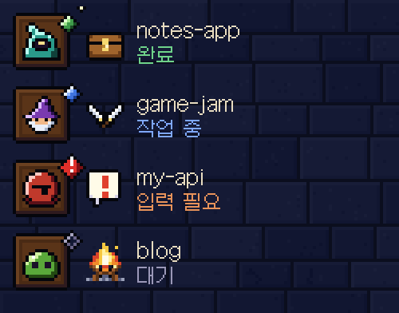

| | |
|---|---|
| 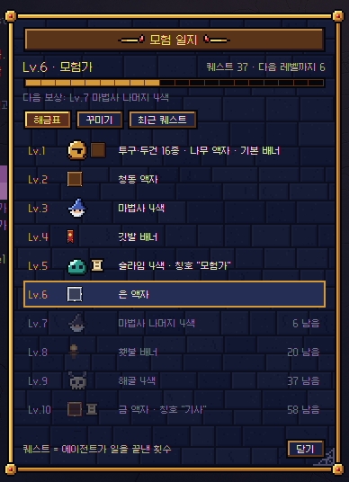 | 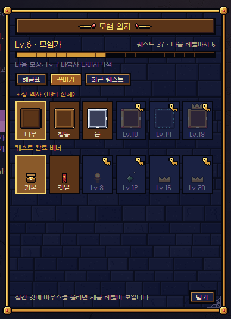 |
| 모험 일지: 레벨별 해금표 | 모험 일지: 액자·배너 고르기 |
| 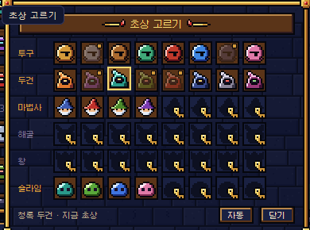 |  |
| 초상 48종 고르기(잠긴 칸은 열쇠) | 파티 목록 |
| 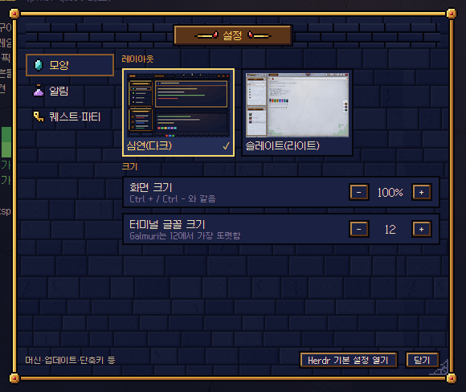 | 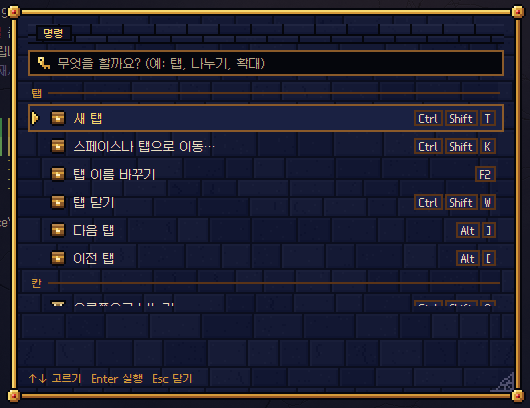 |
| 던전 설정 | 한글 명령 팔레트 |
| 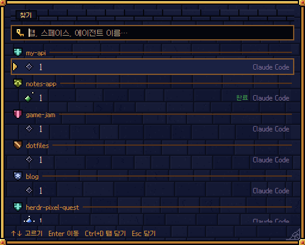 | 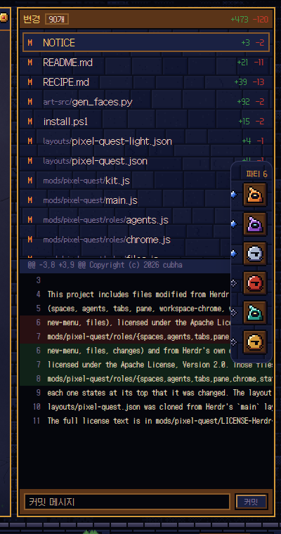 |
| 찾기(탭·스페이스로 이동) | 변경 패널 |
|  | 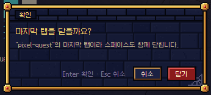 |
| 퀘스트 완료 배너 | 테마 확인창 |
| 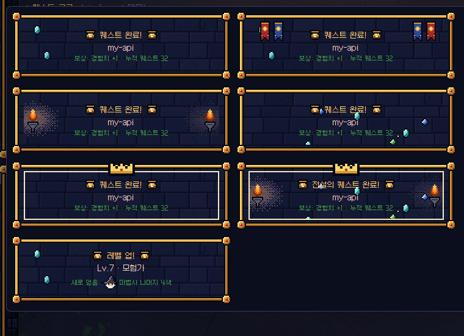 | 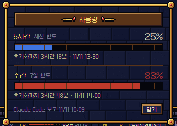 |
| 배너 장식 6종과 레벨 업 | 사용량 카드(실시간 갱신) |

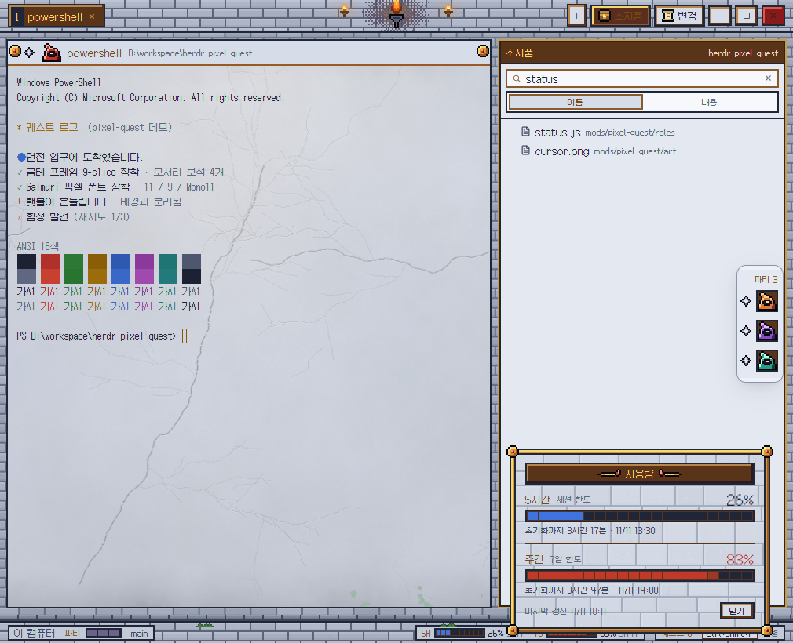

## 설치

Herdr 데스크톱 앱이 먼저 설치돼 있어야 합니다. 설정 폴더는 Windows `%USERPROFILE%\.config\herdr-app`, macOS·Linux `~/.config/herdr-app`입니다(`HERDR_APP_HOME`을 정했으면 그쪽).

### 1. 내려받기

```powershell
git clone https://github.com/cubha/herdr-pixel-quest.git
cd herdr-pixel-quest
```

git이 없으면 GitHub 페이지의 **Code → Download ZIP**으로 받아 압축을 풉니다.

### 2. 적용 — Windows

받은 폴더에서 PowerShell로 실행합니다.

```powershell
powershell -ExecutionPolicy Bypass -File install.ps1
```

| 옵션 | 하는 일 |
|---|---|
| `-Sounds` | 알림음을 8비트 효과음으로(`settings.json`, 처음 한 번 `settings.json.bak` 백업) |
| `-Palette` | `Ctrl+Shift+P`는 테마 명령 팔레트, `Ctrl+Shift+K`는 테마 찾기, `F2`·`Shift+F2`는 테마 이름 바꾸기, `Ctrl+?`는 테마 단축키 창으로(`keys.json`, `keys.json.bak` 백업. 각 키가 Herdr 기본값일 때만 바꿈) |
| `-Light` | 라이트 버전으로 전환 |

예: `powershell -ExecutionPolicy Bypass -File install.ps1 -Sounds -Palette`

설치 스크립트는 레이아웃·테마를 복사하고 `mods\pixel-quest` 폴더를 통째로 바꿉니다. 끝나면 Herdr에서 레이아웃을 고르거나 아래 명령을 실행합니다.

```powershell
& "$env:LOCALAPPDATA\Programs\herdr-app\herdr-app.exe" do layout.switch --name pixel-quest
```

### 2. 적용 — macOS · Linux (직접 복사)

```sh
H=~/.config/herdr-app
cp layouts/pixel-quest*.json layouts/pixel-quest*.png "$H/layouts/"
cp themes/pixel-quest*.json "$H/themes/"
rm -rf "$H/mods/pixel-quest" && cp -r mods/pixel-quest "$H/mods/"
herdr-app check "$H/mods/pixel-quest"
herdr-app do layout.switch --name pixel-quest
```

테마 파일(`themes/pixel-quest*.json`)을 빠뜨리면 레이아웃이 기본 색으로 보입니다. 라이트 버전은 `layout.switch --name pixel-quest-light`, 원래 레이아웃은 `Ctrl+Shift+L`. 폰트(Galmuri)는 모드 폴더에 들어 있어 따로 설치하지 않습니다.

### 3. 업데이트

```powershell
cd herdr-pixel-quest
git pull
powershell -ExecutionPolicy Bypass -File install.ps1
```

- ZIP으로 받았다면 새 ZIP을 받아 같은 방법으로 `install.ps1`을 실행합니다. 이미 준 `-Sounds` · `-Palette`는 다시 주지 않아도 됩니다.
- 퀘스트 수·레벨·고른 초상·액자는 Herdr 공유 상태에 저장돼 업데이트로 지워지지 않습니다.
- 레이아웃 파일을 직접 고쳐 썼다면 덮어써지니 먼저 백업하세요.
- Herdr는 그림을 파일 이름으로 기억하므로, 업데이트 뒤 Herdr를 한 번 껐다 켜는 것이 좋습니다.
- 사용량 게이지를 쓰는 중이면 상태줄이 부르는 `pq-usage.js`도 새 파일이어야 합니다. 저장소 안의 `tools/pq-usage.js`를 가리키고 있으면 `git pull`로 함께 바뀌고, 다른 곳에 사본을 두었다면 새 파일로 덮어씁니다.

### 4. 되돌리기

Herdr에서 다른 레이아웃을 고르면 테마가 빠집니다. 완전히 지우려면 설정 폴더의 `layouts\pixel-quest*`, `themes\pixel-quest*`, `mods\pixel-quest`를 지우고, `-Sounds`·`-Palette`를 줬다면 `settings.json.bak`·`keys.json.bak`으로 되돌립니다.

### 선택 기능

**테마 팔레트·찾기·이름 바꾸기·단축키 연결:** `keys.json`에서 `"ctrl-shift-p": "app.palette"`→`"pixel-quest.palette"`, `"ctrl-shift-k": "mod.open:picker"`→`"pixel-quest.goto"`, `"f2": "tab.rename"`→`"pixel-quest.rename_tab"`, `"shift-f2": "space.rename"`→`"pixel-quest.rename_space"`, `"ctrl-?"`·`"ctrl-shift-/"`·`"ctrl-shift-?"`의 `"app.help"`→`"pixel-quest.help"`로 바꿉니다(`-Palette`가 백업 후 이 줄들만 바꿈). 되돌리려면 원래 값으로 돌립니다. 사이드바 돋보기 버튼은 키와 상관없이 테마 찾기 창을 엽니다. 테마 팔레트 안의 "Herdr 기본 팔레트 열기"로 원래 팔레트도 쓸 수 있습니다.

**효과음:** 에이전트 알림음을 8비트로 바꾸려면 `settings.json`에 아래 내용을 넣습니다.
이 설정은 모든 레이아웃에 적용됩니다.

```json
{ "sounds": { "enabled": true,
  "done": "mods/pixel-quest/sounds/quest-done.mp3",
  "blocked": "mods/pixel-quest/sounds/quest-blocked.mp3" } }
```

**사용량 게이지 연결:** 게이지는 Claude Code가 상태줄 명령에 넘겨 주는 `rate_limits`(claude.ai Pro·Max, 세션의 첫 응답 이후)를 씁니다. `tools/pq-usage.js`가 그 값만 Herdr 설정 폴더의 `pixel-quest-usage.json`에 저장하고, 상태바와 사용량 카드는 파일이 바뀌는 즉시 다시 읽습니다. Claude 세션이 여럿이면 쉬던 세션이 옛 값을 넘기므로, 같은 시간 창에서는 더 큰 값을, 새 창이 오면 새 값을 남깁니다. 토큰을 읽거나 네트워크로 보내지 않습니다. `~/.claude/settings.json`:

```json
{ "statusLine": { "type": "command",
  "command": "node /path/to/pq-usage.js -- <원래 상태줄 명령>" } }
```

상태줄이 없으면 `node /path/to/pq-usage.js`만 넣습니다. Node로 만든 상태줄이면 그 안에서 `require("/path/to/pq-usage.js").save(input)`를 불러도 됩니다. Claude Code는 WSL에, Herdr는 Windows에 있으면 `PQ_USAGE_FILE=/mnt/c/Users/<나>/.config/herdr-app/pixel-quest-usage.json`을 지정하세요. 파일이 없으면 게이지는 나오지 않습니다. 모델별(예: Fable) 주간 한도는 상태줄 값에 없어서 표시하지 않습니다.

**명령:** `herdr-app do pixel-quest.quest`는 퀘스트 배너를 한 번 띄워 봅니다(퀘스트 수에는 세지 않음). `pixel-quest.quest_reset`은 퀘스트 수를 0으로 되돌립니다(얻은 꾸미기는 남음). `pixel-quest.palette` · `pixel-quest.goto` · `pixel-quest.settings` · `pixel-quest.journal` · `pixel-quest.help` · `pixel-quest.rename_tab` · `pixel-quest.rename_space`는 팔레트·찾기·설정·모험 일지·단축키·탭/스페이스 이름 바꾸기를 엽니다. keys.json에 `"<키>": "pixel-quest.<명령>"`으로 묶을 수 있습니다.

## 폴더

| 경로 | 내용 |
|---|---|
| `layouts/pixel-quest.json` | 레이아웃. Herdr 기본 `main`을 복제한 뒤 모양과 모드 연결을 바꿈 |
| `layouts/pixel-quest-light.json` | 라이트 레이아웃(청회색 슬레이트) |
| `themes/pixel-quest-light.json` | 라이트 테마 |
| `install.ps1` | Windows 설치 스크립트(`-Sounds`, `-Light`, `-Palette`) |
| `themes/pixel-quest.json` | 테마. 터미널 ANSI 16색과 패널 색 |
| `mods/pixel-quest/` | 모드 하나를 역할(role)별로 나눔: `chrome` `spaces` `agents` `tabs` `pane` `status` `menu` `newmenu` `quest` `party` `sill` `usage` `files` `picker` `journal` `changes` `settings` `palette` `confirm` `goto` `prompt` `help` `worktree` `machine`. `kit.js`가 팔레트, 픽셀 단위, 프레임, 보석, 버튼을, `progress.js`가 레벨 곡선과 해금표를, `dialogs.js`가 이름 바꾸기·단축키 목록의 글과 무리를 담당 |
| `tests/` · `verify.sh` | `node --test tests/*.test.mjs`(레벨·해금 계산, 사용량 병합, 단축키·이름 바꾸기 글), `bash verify.sh`(테스트 + JSON + 역할마다 `herdr-app check`) |
| `art-src/gen_v3.py` | 도트 에셋 생성기(PIL). `python3 art-src/gen_v3.py art/v3` |
| `art-src/gen_extras.py` | 미리보기 그림과 8비트 효과음 생성기(PIL, ffmpeg) |
| `art-src/gen_dungeon.py` | 던전 디테일 텍스처(석판, 벽돌 띠, 문턱, 횃불빛, 촛대, 사슬, 거미줄, 이끼) 생성기. `python3 art-src/gen_dungeon.py mods/pixel-quest/art` |
| `art-src/gen_tablet.py` | 터미널 뒤 통짜 석판(다크·라이트) 생성기(numpy) |
| `art-src/gen_faces.py` | 파티 초상 48종(+잠긴 초상 실루엣) 생성기. `python3 art-src/gen_faces.py mods/pixel-quest/art` |
| `art-src/gen_rewards.py` · `gen_battle.py` · `gen_rest.py` · `gen_thumbs.py` | 액자 6종·깃발·왕관, 칼·불꽃, 모닥불·보상상자·말풍선, 설정 창 레이아웃 미리보기 생성기(같은 방식으로 실행) |
| `art-src/gen_party_gif.py` | README의 파티 연출 GIF. `python3 art-src/gen_party_gif.py mods/pixel-quest docs/screens/party-effects.gif` |
| `art/` | 생성된 에셋(v3 최종, v2 이력, extras) |
| `mockups/render-v3/` | 최종 디자인 시안(v3). 브라우저로 바로 열림 |
| `docs/screens/` | README 화면. 캡처는 데모 스페이스에서 찍고 실제 이름은 데모 이름으로 바꿈 |
| `tools/` | `demo.ps1`(미리보기용 데모 화면), `redact.py`(캡처 속 이름을 데모 이름으로 바꾸기), `pq-usage.js`(사용량 게이지 연결) |

## 디자인 규칙

- 그리드: 아트 1px = 화면 2px. 선, 그림자, 간격은 모두 2의 배수
- 글꼴: Galmuri11 12px(본문), Galmuri9 10px(보조), 터미널 GalmuriMono11 12px. 굵게 대신 밝은 색으로 강조
- 그림자는 반투명 없이 잉크 `#05060c` 단색
- 디더는 명도가 바뀌는 띠에만 사용
- 의미색: 금색은 장식과 선택에만 / 완료 `#3f9a4a` / 경고 `#ff9a2a` / 입력 필요 `#c0392b` / 작업 `#3f74e0` / 대기 `#6a6488`
- 상태 보석은 색과 모양을 함께 씀: 입력 필요는 `!` 각인과 맥동, 완료는 별빛, 대기는 속이 빈 보석, 작업은 두 프레임 반짝임

## 한계 (Herdr 0.1.14 기준)

- 도트 PNG는 `zoom`과 상관없이 화면 1:1로 그립니다(`kit.js`의 `unit()`). 125%·150% Windows 화면 배율에서는 이미지가 보간되어 조금 흐려질 수 있습니다. 이 구성은 100% 배율에서 확인했습니다.
- 알림 토스트, 엿보기 막대, 환영 화면, Herdr 기본 설정 창, 그리고 **단축키로 닫을 때의** 확인 대화상자는 Herdr가 직접 그리므로 테마 색과 글꼴만 반영됩니다(이름 바꾸기·단축키·워크트리·머신 추가 창과 테마에서 닫을 때의 확인창은 테마가 그림. 이름 바꾸기·단축키는 `-Palette`로 키를 연결해야 키로 열 때도 테마 창). 퀘스트 배너는 별도 창으로 띄웁니다.
- Herdr 애니메이션은 위치·투명도를 오가는 것만 되므로, 보석 비는 배너가 떠 있는 동안 타이머로 움직입니다.
- 파티 서랍과 기본 우클릭 메뉴의 바깥 틀(둥근 모서리, 그림자)은 Herdr가 그립니다.
- 소지품(Files)·변경(Changes) 패널은 Herdr 기본 모드를 고쳐 테마가 그립니다(소지품에는 검색을 붙임). 미리보기는 특정 줄로 이동하는 기능이 Herdr 편집기에 없어서 줄 번호만 머리에 표시합니다.
- 패널을 열면 오른쪽 파티 서랍이 패널 위에 겹칩니다.
- 모드는 Herdr 기본 모드를 복제해 만들었으므로 Herdr가 업데이트되어도 자동으로 따라가지 않습니다.

## 라이선스

- 이 저장소의 레이아웃, 테마, 도트 에셋, 효과음, 생성기, 모드 코드: MIT — `LICENSE` 참고. Copyright (c) 2026 cubha
- `mods/pixel-quest/roles/` 중 `spaces` `agents` `tabs` `pane` `chrome` `status` `menu` `newmenu` `files` `changes`, `prompt` `help` `worktree`, 그리고 `goto`(기본 `picker` 모드)·`machine`(기본 `machine-add` 모드)은 Herdr 0.1.14 기본 모드, `palette`는 Herdr의 명령 팔레트(Apache License 2.0)를 고친 파일입니다. 각 파일 머리에 변경 사실을 적었습니다. 원문: `mods/pixel-quest/LICENSE-Herdr-Apache-2.0.txt`, `NOTICE`
- Galmuri 폰트: © Lee Minseo, SIL Open Font License 1.1 — `mods/pixel-quest/fonts/`
