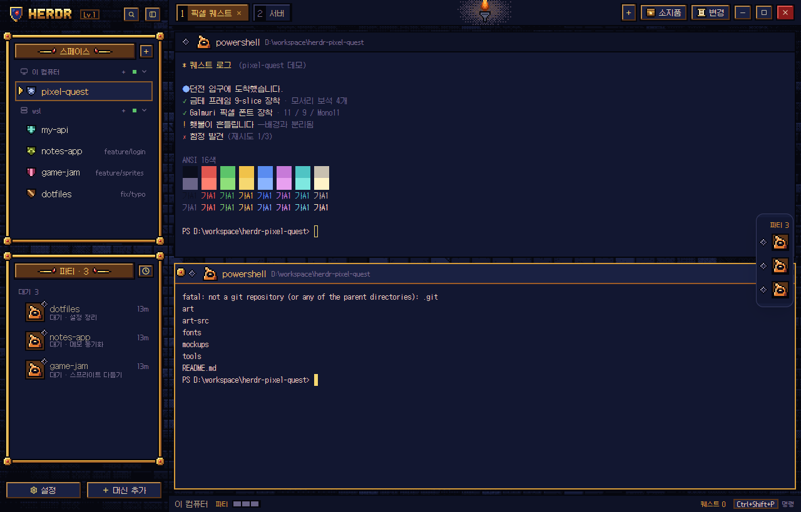

# Pixel Quest

A dark pixel-art "abyss inventory" window for Herdr: a stone wall behind
gold-framed panels with gem knobs, a torch hanging over the tab bar, agents
shown as a party with portraits and status gems, a "퀘스트 완료" (quest
complete) banner when an agent finishes, and 8-bit alert sounds. All labels
are Korean; every picture is original pixel art.

## What you see

- **Whole window** (1280×820 at zoom 1): background image `mods/pixel-quest/art/bg-work.png`
  (a low-contrast dungeon wall, `#0b0e1c`–`#1a2142`, `fit: cover`), divider 2px `#05060c`.
  Fonts: Galmuri11 for mods (12px; captions Galmuri9 10px), GalmuriMono11 12px for terminals.
- **Sidebar, left, 268px**:
  - Brand bar, 42px (as tall as the tab bar, so the panels' gold tops line up with the terminal's): a shield emblem (24×28), the "HERDR" wordmark (76×22), a `Lv.n 칭호` chip
    (bronze outline, gold text; gold and pulsing from Lv.19; a click opens the adventure log), then pixel buttons for search and folding the sidebar.
  - **스페이스** (spaces) panel: a gold frame (ink 2px, light `#f6d870`/dark `#9a5a26` bevel 2px,
    mid `#d49a3a` 2px, ink 2px, fill `#121731`) with 16×16 ruby knobs on its corners, then a bronze
    plaque (`#5a3418`, gold text `#f6d870`, small spear ornaments) and a `+` pixel button. Machine
    headers in Galmuri9. Each space row is 32px: a 16×16 crest (five colors, from the
    space's stored color), the name, and the branch on the right in `#7a7090`. The selected row has a
    2px bronze `#8a5a2a` outline on `#1a2142` and a pointing-hand cursor that nudges 2px left and right.
  - **파티 · n** (party) panel: the same frame. Group headers are "입력 필요 / 완료 / 작업 중 / 대기".
    Each agent row is a 44px card: a 24×24 portrait (one of 48: helm, hood, wizard, horned skull,
    king and slime in eight colorways each; helm and hood from the start, the rest by level; chosen
    by the agent's space name, distinct while there are faces to go round) inside the party's 36×36
    frame (wood, bronze, silver, gold, rune with a pulsing glow, crown rising 8px above), the status
    gem on its corner, then a 24px party slot in every row, so names line up (working: two 16px swords
    slide together 4px and back every 0.56s while a spark fades in; idle: a campfire whose second flame
    frame fades in over the first every 0.45s, two embers rising; done: the open chest fades in over the
    shut one over 1.2s with a glint; blocked: a "!" bubble bobbing 4px; all off with shared pq.battle =
    false, the slot stays), the name (gold when focused)
    with machine and age, and a status line under it (or a moving blue bar while working).
    A blocked agent's card has a red outline.
  - Footer, 32px: "설정" (settings) and "머신 추가" (add machine) as bronze pixel buttons, on the
    status bar's line; the panels' gold bottoms line up with the terminal's.
- **Tab bar, 42px**, `#0e1226` with a 2px ink bottom line: tabs are bevelled boxes with an ink
  number cell, then the name (an automatic number shows the program's name instead), and a gem when
  the tab isn't idle. The active tab is brown `#5a3418` with gold text. A torch (18×38)
  with a dithered glow (96×60, opacity loop 0.7–1, 1.6s) hangs in the middle. On the right: `+`,
  "소지품" (Files, chest icon), "변경" (Changes, scroll icon), and the window buttons (close is red).
- **Panes**: 8px gaps, no radius, border 2px ink, focus 2px `#d49a3a`. Header 32px: a status gem,
  a portrait (click: the picker), the party slot, the name, the folder (Galmuri9, dim) and a status word. The focused pane's header is
  `#1a2142` with gold knobs at both ends. Hovering shows four 16px item-icon buttons: split right,
  split down, zoom and close.
- **Status bar, 28px**: the machine, "파티" and one 14px cell per agent in its status color,
  "! n 입력 필요" pulsing when someone is blocked, the branch, two usage gauges ("5H", "7D": ten 5px
  cells each in a bronze box, the percent and the time to reset; blue under 50%, orange to 79%, red
  from 80% with the last cell pulsing), "퀘스트 n" with ten cells filling toward the next level (click: the adventure log), and the palette
  key in a bronze chip (click: the theme palette).
  Clicking the gauges opens the usage card: a 340×296 frameless popup with a gold frame and stone
  floor, a "사용량" plaque, then for 5시간 and 주간 a big percent, a 20-cell bar and "초기화까지 3시간 18분 · 11/11 13:30",
  and the last update time with a 닫기 button.
- **Side panel** (Files / Changes, hidden by default) inside a 2px gold border. Files is role
  `files`: a bronze header ("소지품", the folder), a search box (search icon, input on a sunk well,
  clear ×) and a 이름 / 내용 switch, then the tree with chevrons, folder/file icons and git marks.
  Typing lists name matches (with the folder dimmed beside) or content hits (file, `:line`, the line).
  A file opens as a read-only preview with line numbers. Changes is role `changes` (Herdr's
  changes mod restyled): a bronze "변경" header with the count and +/−, the changed files on the
  stone floor, the diff, and a commit message well with a 커밋 button. Both panels have the stone floor.
- **Light look** (`pixel-quest-light`): blue-grey slate wall and tablet, panels `#e4e8f0`, ink
  `#1f2638`, text `#1c2233`, gold text `#7a4a0c`; `kit.js` switches palette and the `-slate` textures
  when the shown theme's background is light.
- **Party drawer**: a floating block on the right edge of the work area, peeking 58px:
  gems and framed portraits on the edge side over the stone floor; hover slides out names and status words.
- **Portrait picker** (click a portrait): a 392×352 popup, gold frame, stone floor, "초상 고르기"
  plaque, six rows of eight 30px tiles. The current one is raised with a gold border; one another
  agent shows is at 40% with a gold dot; a locked one is a black silhouette with a key. The line
  at the bottom names the hovered one ("청록 두건 · web-shop이(가) 쓰는 중", "Lv.9에 해금 · 34 퀘스트 남음");
  "자동" drops the pick, "닫기" closes. Picks live in `pixel-quest.faces`.
- **Adventure log** (role `journal`, 380×520 dialog): "모험 일지" plaque, `Lv.n · 칭호`, quests and
  how many to the next level, a 20-cell bar, the next reward, then tabs 해금표 (Lv.1–20 with icons,
  locked ones dim with "n 남음"), 꾸미기 (frame and banner slots; locked: dim art, key, "Lv.n") and
  최근 퀘스트 (`pq.log`, newest 30: time and space).
- **Settings** (sidebar 설정, role `settings`, 560×470 dialog) and **palette** (`pixel-quest.palette`,
  role `palette`, 520×400 dialog): gold frame, stone floor, brick band; see the README for what they hold.
- **Go to** (sidebar search button, `pixel-quest.goto`, role `goto`, 520×420 dialog): Herdr's `picker`
  rows and keys (Apache-2.0) in a gold frame on stone with a brick band "찾기", the space's crest over its
  tabs, status gems, the cursor; Korean words. **Party sort** (the clock button): a frameless 180×100 popup
  dressed like the theme menus (thin gold, stone, band "파티 정렬", cursor on the sort in use).
- **Confirm** (role `confirm`, 340×150): closing a space, or a space's last tab, from the theme's
  menus or tab ×: a brick band "확인", the question, the detail, 취소 and a red 닫기 (Enter/Esc).
- **Rename** (role `prompt`, 380×170, Herdr's `prompt`): tab double-click, the tab and space menus'
  이름 바꾸기, the palette, `pixel-quest.rename_tab` / `rename_space` (F2 / Shift+F2 after `-Palette`).
  Band "탭/스페이스 이름 바꾸기", a well with the scroll icon, a hint (empty = the tab's number / the
  folder's name), 취소 and a gold 저장. Saving always passes `name` ("" too): without it Herdr opens
  its own prompt.
- **Keys** (role `help`, 520×480, Herdr's `help`): the menu's 단축키, the palette, `pixel-quest.help`
  (Ctrl+? after `-Palette`). Band "단축키", a filter well, Korean groups (스페이스 · 탭 · 칸 · 에이전트 ·
  터미널 · 창·앱) under a gold rule, each key as small keycaps, the action in Korean (`dialogs.js`).
- **Worktree** (role `worktree`, 460×250 / open 560×480, Herdr's `worktree`) and **add machine**
  (role `machine`, 540×400, Herdr's `machine-add`): the git and ssh work unchanged, drawn in the gold
  frame on stone with a brick band, cursor rows, keycap-less key line, bronze/gold/red buttons.

## How it behaves

- Status gems (18×18): **working** blue, two frames cross-fading every 0.7s; **blocked**
  red with a "!" mark, pulsing (opacity 0.45–1, 0.9s); **done** green with a star glint; **idle** an empty
  violet gem. Shape and color both change, so they read without color.
- Pixel buttons: bronze bevel; while pressed the bevel flips and the face moves 2px down-right.
- When an agent changes to **done** (Herdr's done: it finished while the person wasn't looking; seen while the layout runs), the status bar opens the
  quest banner: a 360×112 frameless window, gold frame, "퀘스트 완료!", the agent's space, "보상: 경험치 +1 · 누적
  퀘스트 n" and the chosen decoration: 기본 (four twinkling crystals), 깃발 (four swaying pennants and
  crystals), 횃불 (a torch with a pulsing glow at each end), 보석 비 (gems falling, moved by a 50ms timer
  since loops go there and back), 왕관 (a crown on the top edge and a pulsing pale border), 전설 (torches,
  gems and crown, "전설의 퀘스트 완료!"). It closes after 4.5s; clicking it focuses that agent's pane.
  The quest count is shared state `pq.quests`, the log `pq.log`. Levels (`progress.js`): from Lv.n the
  next takes `5 + floor((n-1)^2/4)` quests (Lv.10 at 95, Lv.20 at 620). Unlocks follow the best level
  `pq.best`; on update day the old level (`1 + floor(quests/5)`) is kept as `pq.floor` so nobody drops.
  A new level opens the level-up banner instead (6s): "레벨 업!", "Lv.n · 칭호", "새로 얻음:" with icons.
- `pixel-quest.quest` shows the banner once without counting; `pixel-quest.quest_reset` sets the count to 0.
- Space rows: click selects, drag reorders, right-click opens the menu. Agent rows: click focuses the pane;
  hover shows a pin button. Tabs: click selects, double-click renames, drag moves, right-click opens the menu, scroll switches.
- Menus opened from the spaces list and tab bar are frameless popups with a thin gold frame; every
  menu (the terminal's too) has the stone floor, a 20px brick-band header ("스페이스", "탭", "칸",
  "새로 만들기") and a cobweb; the chosen item shows the cursor. Herdr's item names are shown in Korean.
- Narrower than 160px the sidebar becomes a rail: crests with a corner gem for spaces that need
  you, agent numbers with gems, icon-only footer buttons.

## Built from

- `layouts/pixel-quest.json`: cloned from Herdr's `main` (`layout.clone`), then root look
  (`theme: "pixel-quest"`, `font: "GalmuriMono11"`, `font_size: 12`, `ui_font: "Galmuri11"`,
  background image, `terminal_padding: [12, 10]`, `terminal_menu: "pixel-quest"`,
  `preview: "layouts/pixel-quest.png"`), every block's `content.mod` set to `pixel-quest` with
  `props.role`, the pane frame above, the gold-bordered `panel`, and a `floating` party block on `work-body`.
  Dungeon details: an 8px `sill` block (role `sill`) in the `work` column above `status`; the
  block `main` has `background: { "image": "mods/pixel-quest/art/tablet.png", "fit": "cover" }` (one
  cracked stone tablet at screen resolution, light from the top centre under the tab bar's torch), the
  pane frame's `background` is `#00000000`, and the root has `terminal_opacity: 0.3`. The `files`
  block is `{ "mod": "pixel-quest", "props": { "role": "files" } }`. One backdrop sits behind all panes, so
  split panes share one light instead of each getting its own. Measured: Herdr's opacity is not
  linear (0.82 barely showed, 0.5 matches the mockup); Herdr caches images by path, so a redrawn
  PNG needs a new file name before it shows.
- `themes/pixel-quest.json`: background `#121731`, foreground `#e8dcc0`, cursor `#f6d870`,
  16 ANSI colors tuned for that background (ANSI 8 `#807aa4`, contrast 3.1 at the brightest
  lit slab; the idle status color stays `#6a6488`), panel colors (accent `#d49a3a`; working/blocked/done/idle
  `#3f74e0`/`#c0392b`/`#3f9a4a`/`#6a6488`).
- `mods/pixel-quest/`: one mod in roles (like Herdr 98). Mods can't import from another mod's
  folder, so everything shares `kit.js` inside this folder: palette, `unit()` (art px ÷ zoom so PNGs
  stay 1:1), `pic`, `frame`, `thin`, `plaque`, `panel`, `gem`, `button`, `cursor`, `crest`, `face`, and for the dungeon details
  `texture` (a big PNG at its own size, cut by a `relative().overflow_hidden()` box), `FLOOR`,
  `web`, `chain`; `frame`/`panel` take `{ floor, web }`.
  Roles `spaces`, `agents`, `tabs`, `pane`, `chrome`, `status`, `menu`, `newmenu` are Herdr's shipped
  mods restyled (their data logic is unchanged), `files` is Herdr's files mod with search added;
  `quest`, `party`, `sill` and `usage` are new. Search: names from `git ls-files -co --exclude-standard`
  (else a bounded walk skipping .git and node_modules), content from `git grep -n -I -i -F --untracked`
  (else grep / Select-String), 350ms after typing stops, at most 300 hits; the box is gpui-base
  `InputState`/`Input`.
- Usage: `tools/pq-usage.js` saves `rate_limits.five_hour` / `seven_day` from Claude Code's status line
  input into `<app home>/pixel-quest-usage.json` (only when changed); `status` reads it with
  `readTextFile` every 20s. No per-model limits: Claude Code doesn't pass them to the status line.
- Herdr functions: `spaces`, `agents`, `terminals`, `panes`, `focused`, `run`, `openOverlay`,
  `closeOverlay`, `shared`/`setShared`, `nextCommand`, `placement`, `knownAgents`, `exec`/`hc` (the
  spaces role's git and machine checks, as in Herdr's own).
- Art: `art-src/gen_v3.py` (every PNG, drawn at 1x and doubled with nearest neighbour) and
  `art-src/gen_extras.py` (the preview, and the MP3s via ffmpeg).
- Dungeon details: `art-src/gen_dungeon.py` writes the floor, brick band, sill, lit slabs,
  sconce, chain, cobweb and moss PNGs. Big textures sit at their own size in a
  `relative().overflow_hidden()` box (`kit.js` `texture()`), so they are cut, never stretched.
- Portraits: `art-src/gen_faces.py`; tablet: `art-src/gen_tablet.py` (numpy).
- Fonts: Galmuri11, Galmuri11 Bold, Galmuri9, GalmuriMono11 TTFs in `mods/pixel-quest/fonts/` (OFL).

## Watch out

- Copy `themes/pixel-quest.json` too (not only `layouts/` and `mods/`), or the layout falls back
  to the default palette.
- Never show a PNG at a size other than its file size: GPUI filters images. Frames are bordered
  divs, not stretched images; only the corner knobs are pictures.
- `import "../other-mod/x.js"` is refused ("resolves outside the application directory").
- On the right edge, a peeking float shows the **right** side of its content: put the gems and
  portraits last in each row there.
- Herdr's welcome, palette, settings, toasts and peek bar, the frame of floats and app-opened menus,
  and its dialogs when Herdr itself opens them (a close by key, its settings' Machines) are Herdr's:
  they take the theme and fonts only. A layout can only swap the terminal menu (`terminal_menu`).
- `herdr-app check` renders the mod without props; to check each role, copy the folder and
  force `props.role` in `main.js`.
- Herdr's JS `Date` ignores `toLocaleString` options: format dates by hand.
- `.transition("left", …)` did not move an element in Herdr 0.1.15 (measured: the target changed,
  the element stayed); `.spring("left", { response, damping: 1 })` does. The pet walks on a spring.
- There is no image flip: mirrored art is its own file (`pet-*-r.png`).
- `notify()` called while a view renders never shows (measured): the status bar sees quests and
  the full party in `render`, so their medals queue and go out from a 0.5 s timer.
- The status block is 44 px: the 8 px gap and the 8 px stone sill above the 28 px bar are drawn by
  the status role, so the pet's marks can stand above its head (look.js moves older layouts).
- A light theme needs its own well color for inputs: text on `P.ink` vanishes there (`P.well`).
- Galmuri is crisp at 12px (11) and 10px (9); other sizes blur. At Windows display scaling of
  125% or 150% the 2x art is resampled.

## Done when

- `herdr-app check mods/pixel-quest` passes, and with `role` forced to each of `pane spaces agents
  tabs chrome status menu newmenu quest party sill usage files` it still passes.
- `layout.switch {name: "pixel-quest"}` leaves `herdr-app status` with no errors and no `layout.error`.
- A `herdr-app shot` at zoom 1 shows: the gold knobs crisp (no blur), Galmuri in the sidebar and
  terminals, the torch over the tab bar, a cursor on the selected space.
- `herdr-app do pixel-quest.quest` shows the banner, and it is gone 5s later.
- Folding the sidebar (`layout.resize {id: "sidebar", px: 44}`) shows crests, not names.
